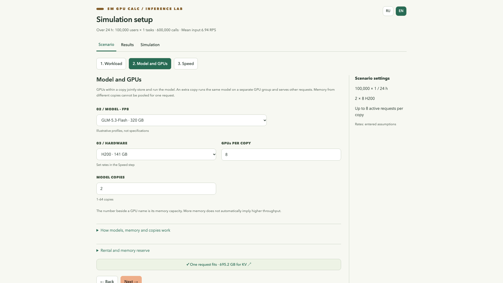
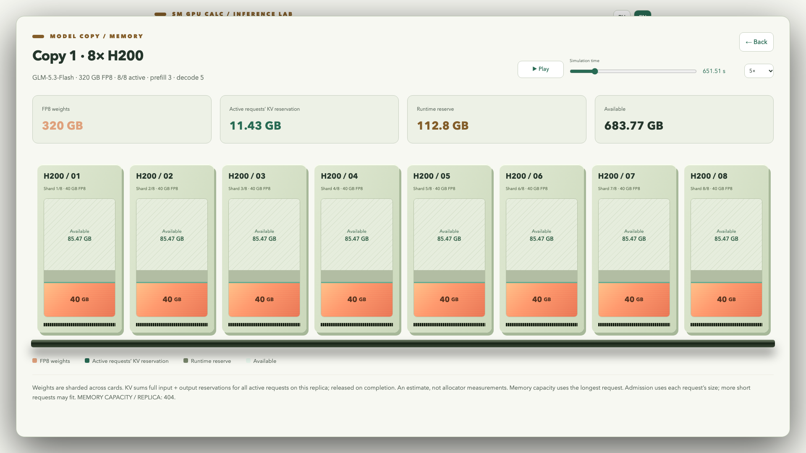

# SM GPU Calc

**LLM workload → queue → GPU replicas → memory, latency and cost.**

[Open the calculator](https://mikhaylov.com/gpu-calc/?lang=en) · **English** · [Русский](README.ru.md)

`MIT` · `HTML / CSS / JavaScript` · `Static hosting` · `RU / EN`

An interactive, educational GPU inference simulator. Explore how request arrivals,
parallel processing and KV memory affect queues and latency. All calculations run
in your browser; model profiles and throughput curves are assumptions, not benchmarks.

### Guided setup

Start with **Workload → Model and GPUs → Speed**, then open **Results** and
**Simulation**. Explanations connect the settings to memory and response time.
Setup and results use a responsive light layout. Imported workloads remain local.



### Inside a replica

Open a replica to see model shards, KV reservations, runtime reserve and free memory
on each GPU. Playback controls also work here.

The simulation uses the original deterministic scheduler. Slot occupancy and KV
use have separate indicators; the explanation describes the selected instant,
not measured hardware utilization. An illustrative speed example uses your
workload’s mean token lengths; actual latency metrics come from the full replay.



### What you can explore

- **Workload:** start with the demo, create a uniform request stream, or import CSV.
- **Hardware:** choose a model profile, H200/B200/B300, 1–16 GPUs per replica and 1–64 replicas.
- **Parallelism:** allow 1–256 active requests per replica and set an explicit throughput-gain assumption.
- **Memory:** each active request reserves KV; requests wait if slots or memory are unavailable. Memory is released on completion.
- **Playback:** follow prefill/decode phases, queue length, completed requests and free KV memory. Drill into a replica without stopping playback.
- **Results:** compare run duration, peak queue, p95 time to first token, total rental and cost per request.
- **Scenarios:** save variant A for comparison, export results as CSV, and save/reopen JSON scenarios.

A **replica** is one copy of the model spread across its GPUs. Eight GPUs in a
replica jointly serve its requests; they are not eight independent model copies.

### Run locally

Download or clone the repository, then run from its root:

```sh
python3 -m http.server 8000 --directory distr
```

Open [localhost:8000](http://localhost:8000/). You can also open `distr/index.html`
directly; keep `sim-core.js` and `scenario-core.js` beside it. No npm installation,
backend or GPU is required. The unified page has no external runtime resources.

### Create a workload

**Example** replays the [live OpenClaw trip-planning run](examples/trip-moscow-nizhny/live_run.md)
with **6 model calls per task**. Set **Users**, **Tasks / user**, and **Period · hours**.
Default: **100,000 users × 1 task over 24 hours** → 600,000 calls, mean **6.94 RPS**.
The profile button selects uniform arrivals or 24 editable hourly weights (relative
weights, normalized to the total task count). Hourly mode uses a 24-hour period.
Tasks arrive independently; repeat tasks do not model a user's session.

The detailed replay covers a **1–60 minute window** (15 by default), starting with
an empty pool at hour 0 or the busiest hour. It retains every call of each task
starting in that window, including calls and completion after its end. At most
1,666 tasks / 9,996 calls are replayed; larger demand shortens the window instead
of reducing arrival intensity. **Latency, queue and rental results describe only
this excerpt and its drain, not the whole day.** Earlier backlog is not carried in;
the excerpt is not a full-day capacity/SLO validation.

Each task contributes **28,200 input + 2,400 output tokens**. Provider totals are
measured; their per-call allocation is reconstructed (`live_run_reconstructed`).
Call intervals come from the trace and do not adapt to simulated completion times.
User limits: 1–10 million; tasks/user: 1–100; period: up to 168 hours.
These controls apply to OpenClaw; manual and CSV workloads keep their own arrivals.

**Create** opens a uniform-flow form for total model calls, RPS, input tokens and
output tokens per call; it does not replicate the six-call user workflow.
**RPS** means incoming requests per second, not completed responses per second.
The simulator uses token counts; it does not send prompts to an actual model.

CSV requires these four columns:

```csv
request_id,arrival_ms,input_tokens,output_tokens
r1,0,10000,1000
r2,200,10000,1000
r3,400,5000,500
```

`arrival_ms` is time from the scenario start. IDs must be unique; token counts and
arrival times must be integers, input ≥ 0 and output ≥ 1. Limit: 10,000 requests,
2 MiB per CSV. The simple parser does not support quoted or multiline fields.
Additional metadata is preserved; dependencies do not affect execution.
Files are processed locally in your browser.

### Users, calls and RPS

Mean period demand = users × tasks/user × 6 / period seconds. Hourly peak is the
highest hour's allocated tasks × 6 / 3600; it is an assumed hourly mean, not the
maximum number of actual arrivals in one second. **How to read RPS?** shows both
period totals and the replay's measured one-second arrival peak, plus its average
output including idle time and drain. RPS is not GPU utilization; all GPUs within
a replica serve each call together.

### Hardware presets

The hardware selector supports H200 (141 GB), B200 (192 GB), and B300 (288 GB).
B300 memory follows the [NVIDIA DGX B300 User Guide](https://docs.nvidia.com/dgx/dgxb300-user-guide/introduction-to-dgxb300.html),
checked 2026-10-14. Its initial prefill/decode rates and $5/GPU-hour rental are
**placeholders copied from the B200 preset**, not B300 benchmarks or a provider quote.
Replace them with your measured rates and rental. Extra VRAM changes memory admission;
it does not automatically increase throughput. Memory uses decimal GB and the selected runtime reserve.

### Interpret the results

Solo prefill/decode rates are for one request on the **whole replica**, not each
GPU. With `n` active requests and gain `g`, assumed aggregate throughput scales as
`G(n) = 1 + (n − 1) × g`; each request receives `G(n) / n` of its solo rate.
The UI expresses `g` as a percentage: 0% shares fixed throughput, 100% assumes ideal
linear scaling. The default 50% is illustrative and should be replaced with measurements.

KV reserves the full input + output context at admission. It changes when requests
start or finish; gradual token-by-token growth and prefix-cache reuse are not modeled.
The memory-capacity estimate uses the longest request. Free memory alone does not
guarantee fast responses or a particular number of users.

The displayed queue restriction describes this scheduler's slot/memory limits,
not the physical GPU bottleneck. Profiles are not calibrated; there is no chunked
prefill, interconnect model, preemption or DAG execution. Rental includes all GPUs
from the scenario start to the last completion, including idle time.

See the [calculation contract, formats and limitations](docs/UNIFIED-SCENARIO.md).

### Share settings

URLs can initialize `lang`, `model`, `gpu`, `replicas`, `cards`, `prefill`, `decode`,
`price`, `reserve`, `concurrency` and `batchGain`. Demo parameters are `users`, `tasksPerUser`, `periodHours`,
`profile=uniform|hourly`, `windowMinutes` and `hourWeights` (24 comma-separated weights). Model keys are `glm53`, `flash`
and `qwenflash`. `progress=0..1` selects a point in the run; `drill=1` opens a replica.
`view=scenario|review|simulation` selects a section and `step=0|1|2` a setup step.

```text
index.html?lang=en&model=glm53&gpu=B200&replicas=2&cards=8&concurrency=8&batchGain=50
index.html?lang=en&users=100000&tasksPerUser=1&periodHours=24&progress=0.5&drill=1
```

URLs contain settings, not imported workload data. Use a saved JSON scenario to
reproduce a custom workload. Demo JSON also saves user count, tasks per user, period, arrival profile and replay window. Older `/1` scenarios reopen with one active request
per replica; new saves use `/2`.

### Publish to static hosting

```sh
bash scripts/release.sh
```

The script synchronizes `distr/`, runs core tests and browser render checks, versions
JavaScript URLs with content hashes, and creates a ZIP under `releases/`.
It requires Node.js, Python 3 and Chrome (`CHROME_BIN` can specify its path).
There is no automatic upload.

Deploy the **entire generated ZIP** together. It contains the two HTML pages,
two JavaScript cores, `VERSION.txt`, `sitemap.xml` and `share-preview.png`.
Content hashes prevent a new page from using an old
cached engine. Rebuild after editing JavaScript; copying only `index.html` is not
sufficient. Use UTF-8 and serve `index.html` as the directory index.

### Search and link previews

The hosted page includes a descriptive title, description, canonical URL,
Open Graph / Twitter preview and WebApplication structured data. The canonical
search page is `https://mikhaylov.com/gpu-calc/`; alternate HTML filenames and
scenario query strings point to it. Russian metadata is present in the initial
HTML; the English UI updates metadata in the browser and is not a separate
search landing page. The initial heading and JavaScript-disabled explanation
are readable without rendering the application.

The release copies the English overview screenshot to `share-preview.png` and
publishes [the sitemap](https://mikhaylov.com/gpu-calc/sitemap.xml). For a different
host, update the absolute URLs in the HTML and sitemap. Reference the sitemap
from the **host's root** `robots.txt`, or submit it to search webmaster tools.
No analytics counters are installed.

## Repository

| Path | Purpose |
| --- | --- |
| `simulation.html` | Unified interface |
| `sim-core.js` | FIFO scheduling, sharing and KV admission |
| `scenario-core.js` | Profiles, memory, CSV and JSON |
| `distr/` | Static distribution; `index.html` and `simulation.html` are identical |
| `tests/sim-core.test.js` | Core and scenario tests |
| `scripts/release.sh` | Checks, asset versions, distribution and ZIP |
| `scripts/render-check.sh` | Chrome screenshots and runtime checks |
| `docs/UNIFIED-SCENARIO.md` | Calculation contract (Russian) |

## Contributing & license

Run core tests with `node --test tests/sim-core.test.js`. For UI changes, also run
the browser render check and inspect screenshots. See [CONTRIBUTING.md](CONTRIBUTING.md).

[MIT License](LICENSE) · Copyright © 2026 Sergei Mikhailov
[Website](https://mikhaylov.com/gpu-calc/) · [GitHub](https://github.com/bzSega/sm-gpu-calc)

Legacy `usersPerSecond` URLs are converted to a period when `periodHours` is absent.
Scenario JSON preserves the hourly profile and excerpt settings in `workload_source`
(`openclaw-period/1`); older `openclaw-live/1` scenarios remain readable.
